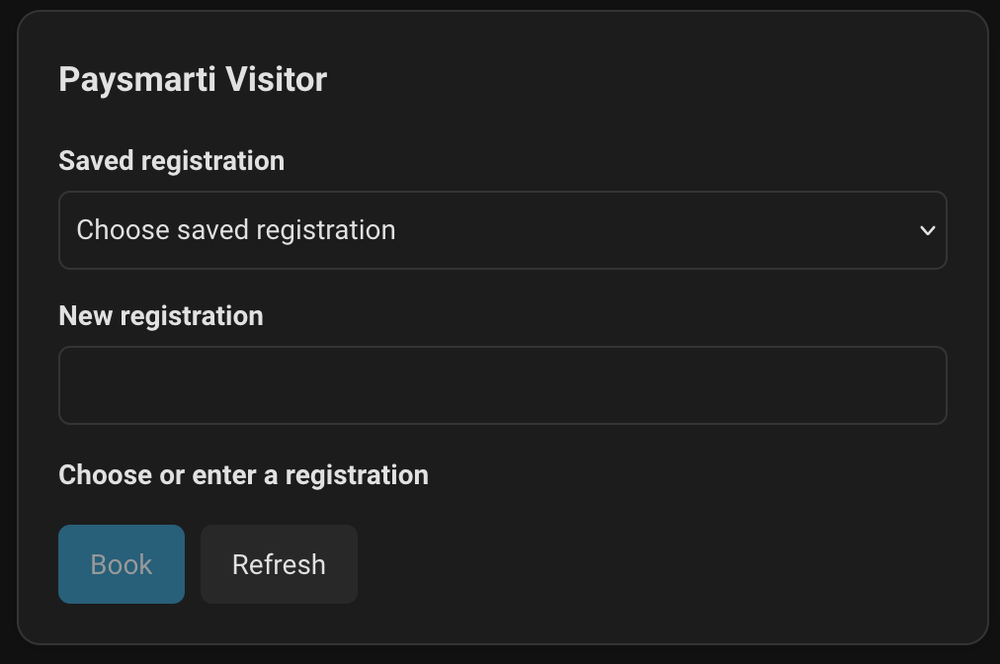

# Paysmarti Visitor for Home Assistant

Licensed under the [MIT License](LICENSE).

Book one visitor vehicle for the current day from Home Assistant. Choose a saved registration or enter a new one; you can also save a new registration with a nickname. The booking starts immediately and runs until 23:59.



The integration uses the Leeds City Council visitor flow on Paysmarti. You need a Paysmarti visitor account and permit that you control. It books one vehicle at a time.

## Install

1. In Home Assistant, install **Home Assistant Marketplace** (formerly HACS) if you do not already have it.
2. In Marketplace, add `https://github.com/RemakingEden/Paysmarti-Hass` under **Custom repositories** with type **Integration**.
3. Find **Paysmarti Visitor** in Marketplace and download it. Restart Home Assistant.
4. Open **Settings → Devices & services → Add integration**, search for **Paysmarti Visitor**, and sign in with your Paysmarti account. Choose your visitor permit and street if prompted.
5. Edit the dashboard where you want the booking control. Select **Add card**, search for **Paysmarti Visitor**, and add it. The card is included with the integration; there is no separate card download or resource setup for a normal Home Assistant dashboard.

If the card does not appear after installation, refresh your browser. If you manage dashboard resources in YAML, add `/api/paysmarti_visitor/paysmarti-visitor-card.js` as a JavaScript module yourself.

## Use the card

- Select a car in **Saved registration**, or type its plate into **New registration**. Typed text takes priority if both fields have values. Check **Effective registration** before booking.
- To save a new plate, open **Settings → Devices & services → Paysmarti Visitor → Configure** and enable **Allow saving a new vehicle**. Then type a new plate in the card, tick **Save this registration**, and optionally enter a nickname. Saving is off by default. A live save with a nickname has been reported successful.
- Select **Book** once. A confirmed booking shows **Booked** with the registration and parking times. **Not booked** means the final booking was not completed. If the card shows **Outcome unknown**, check Paysmarti before trying again: the request may already have succeeded.

For more than one configured Paysmarti account, add a **Manual** card and provide the chosen account's config entry ID:

```yaml
type: custom:paysmarti-visitor-card
config_entry_id: YOUR_CONFIG_ENTRY_ID
```

**Action permissions:** Anyone in Home Assistant who can run the `paysmarti_visitor.book_visitor` action for this config entry can create a real permit booking, including from the Actions interface without the card. Restrict access to trusted Home Assistant users and automations. The card does not store a typed registration in an entity state or browser storage. The integration stores a masked last attempt and leaves its persistent notification until dismissed. The card's **Dismiss** button hides the result only in the current card instance; reopening the card restores the backend result, and the Home Assistant notification remains until dismissed separately.

## Update and troubleshoot

Update **Paysmarti Visitor** under **Settings → Updates** on the Home Assistant server after Marketplace discovers a new GitHub release. If no update appears yet, open its page under **Settings → Marketplace** to refresh repository information, then check Updates again. Restart Home Assistant after the update, and reload the dashboard to refresh the card resource. If the card still uses an older file, clear the browser's cached dashboard resources and reload. A changed Paysmarti form can create a Home Assistant Repair issue; review it and update the integration before retrying. If the card reports **Outcome unknown**, check the Paysmarti site for the booking before making another attempt.

For setup failures, open **Settings → System → Logs**, select **Home Assistant Core**, and search for `paysmarti`. Use **⋮ → Show raw logs** if the condensed view has no match. A failed initial setup has no config entry yet, so its integration debug menu and diagnostics are unavailable. Recent versions log a safe reason for `invalid_auth` without logging the email, password, cookies, tokens, or response body. `invalid_auth` can also mean the site's login flow changed; it does not by itself prove the password is wrong.

For a support report, download the integration's **Diagnostics** from **Settings → Devices & services → Paysmarti Visitor → ⋮ → Download diagnostics**. It contains only version, stage, error code, HTTP status, path without query, form field names, and last attempt status. Review the downloaded file before sharing. If sign-in or discovery fails during startup, Home Assistant may leave the entry unavailable, so the last-result action and diagnostics for that entry may be unavailable until setup succeeds; the recovered persistent notification remains visible. If a maintainer needs a fresh browser-flow capture, reproduce only with a disposable or controlled account and redact credentials, cookies, tokens, full registrations, names, addresses, query strings, and page bodies before sharing; never attach an unredacted HAR or screenshot.

## Development

Install the test dependencies with `python -m pip install -e '.[test]'`, then run `python -m pytest -q` for Python tests and `npm ci && npm test` for the dashboard card tests. The card is a vanilla JavaScript module bundled under `custom_components/paysmarti_visitor/frontend/`; the integration serves it at the dashboard resource path above.
